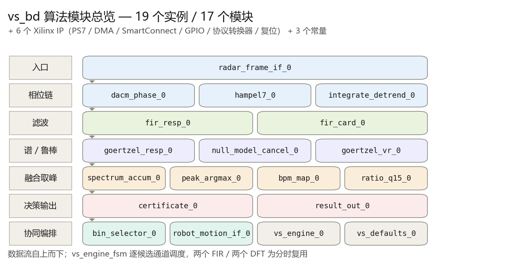

# 毫米波雷达非接触心率估计 · ZYNQ7020 FPGA 实现

把一套 Python 离线算法流水线 —— **IWR6843 毫米波雷达 + AlohaMini 机器人载具的非接触心率监测** ——
完整迁移成可综合的 Verilog，并在 Vivado 里搭出 **28 个单元**的 Block Design。

`xc7z020clg400-2` · Vivado 2019.1 · 纯 Verilog-2001 · 25 个源文件 / 3 356 行 RTL

---

## 目录

- [这是什么](#这是什么)
- [系统架构](#系统架构)
- [三个关键设计决策](#三个关键设计决策)
- [仓库结构](#仓库结构)
- [快速开始](#快速开始)
- [Block Design：28 个单元](#block-design28-个单元)
- [Python → Verilog 对应关系](#python--verilog-对应关系)
- [资源占用与已知限制](#资源占用与已知限制)
- [文档索引](#文档索引)

---

## 这是什么

原始算法在 `../python代码/scr/`，是一条 10 个阶段的离线流水线：

> 4RX×20bin 复数距离像 → DACM 相位 → Hampel 清洗 → 积分去趋势 → 双带通 →
> 呼吸谱峰 → 谐波回归 + 共模抵消 → VR 频率扫描（60–110 bpm）→ 跨分量谱融合 →
> 峰值搜索 → 质量证书分级

本仓库把这个流水线拆成 **可流式综合的定点 RTL**，用 Block Design 显式表达数据流：

- **输入**：PS 经 AXI-DMA 每帧送 80 个 32 位字（`{Q[15:0], I[15:0]}`）
- **输出**：14 个 32 位结果寄存器 + 中断（心率 / 呼吸率 / 质量分 / 决策等级 / 机器人控制字）
- **副产品**：一套不依赖 Vivado 的静态检查脚本 + 自动生成的模块图 / 连线表

---

## 系统架构

```
 PS7 / DDR
    │  AXI-DMA MM2S（每帧 80 个 {Q[15:0], I[15:0]}，首字 TUSER=1、末字 TLAST=1）
    ▼
 radar_frame_if ──► dacm_phase ──► hampel7 ──► integrate_detrend
                                                   │  600×80×24b 窗口存储器
                    ┌──────────────────────────────┴───────────────────────────┐
                    ▼ rd_sel=0                                                ▼ rd_sel=1
          fir_resp（呼吸带 0.15–0.60 Hz）                      fir_card（心脏带 0.80–2.00 Hz）
                    │                                                          │
                    ▼                                                          ▼
       goertzel_resp（91 点谱）                          null_model_cancel（LMS 谐波抵消）
                    │                                                          │
                    │                                                          ▼
                    │                                              goertzel_vr（201 点 VR 曲线）
                    └──────────────────┬───────────────────────────────────────┘
                                       ▼  双写口
                            spectrum_accum（跨 (bin,RX) 非相干累加）
                                       ▼
                              peak_argmax（argmax + 抛物线亚 bin 插值 + 对比度）
                        ┌──────────────┼───────────────┐
                        ▼              ▼               ▼
                   bpm_map        ratio_q15      certificate_fsm ◄── bin_selector
                （→ 心率/呼吸率）  （→ 竞争比）    （质量分级）      ◄── robot_motion_if
                                       │
                                       ▼
                         result_out（14×32b 寄存器 + IRQ）──► PS7 中断
```

`vs_engine_fsm` 是控制中枢：它**逐候选通道**调度整条流水线，所以两个 FIR、两个 DFT
虽然画成两个块，**实际是分时复用的**，不会同时工作。

---

## 三个关键设计决策

### 1. 带通滤波用 1024 抽头线性相位 FIR，而不是 biquad 级联

按 Python 的 `butter(4) + filtfilt` 直接做双二阶级联在定点上会崩：

- scipy 的 SOS 分解把**全部增益压进第一节**，`b0 ≈ 2e-5`
- 而 Q4.14 的量化步长是 `6.1e-5` —— **系数直接被量化成 0**
- 各级增益跨 `0.011 ~ 472` 四个数量级，级间必然下溢

换成 1024 抽头对称 FIR 之后：系数最大 0.123（Q1.15 精度充足）、通带增益
**0.997–1.003**、阻带 −54 dB，而且**对称 FIR 本身就是零相位**，等价于 `filtfilt`，
不需要正反向跑两遍。

### 2. 频谱用任意频点精确 DFT（Goertzel），不用 FFT IP

整个算法只需要约 200 个**特定**频点（呼吸 91 点 + VR 201 点），且频点非均匀。
201×600 ≈ 12 万拍 ≈ 1.2 ms，资源远小于一个 4096 点 FFT，而且频点可以任意指定。

### 3. 存储器的映射方式决定了这颗片子装不装得下

同一段 RTL，`ram_style` 用错就会让 1.15 Mbit 的窗口存储器从"32 个 BRAM"
变成"48000 个 LUT"或"14400 个触发器"。判断规则：

| 存储器的读方式 | 能用的资源 |
|---|---|
| 同步读（1 写 1 读） | ✅ Block RAM |
| 异步读 / 多读口 | ❌ 只能分布式 RAM（LUTRAM），综合器可能还会复制多份 |
| 声明 `ram_style="block"` 但异步读 | ⚠️ 会**退化成触发器** |

详见 [`docs/BlockDesign结构说明.md`](docs/BlockDesign结构说明.md) 第六节的实测数据。

---

## 仓库结构

```
fpga/
├── rtl/                       25 个可综合 Verilog（3 356 行）
│   ├── common/                u_div / median7 / sin_lut
│   ├── frontend/              radar_frame_if · dacm_phase · hampel7 · integrate_detrend
│   ├── spatial/               bin_selector · robot_motion_if
│   ├── filter/                fir_bandpass（1024 抽头）· iir_biquad / biquad_cascade（备选路径）
│   ├── spectral/              goertzel_sweep · null_model_cancel · spectrum_accum
│   │                          · peak_argmax · ratio_q15 · cm_ref_extract（预留）
│   ├── cert/                  certificate_fsm
│   ├── output/                result_out（AXI4-Lite 从端 + IRQ）
│   └── top/                   vs_engine_fsm · bpm_map · vs_defaults · vital_signs_top
├── tb/                        4 个单元 testbench
├── tcl/                       建工程 / 建 BD / 连线 / 综合实现 / 导出框图 / 跑仿真
├── scripts/
│   ├── gen_rom.py             生成 ROM 初值（正弦表 / FIR 系数 / 频率网格）
│   ├── rtl_lint.py            无依赖 RTL 静态检查（保留字 / 例化端口 / ROM 文件）
│   ├── check_bd_nets.py       ★ BD 连线预检（引脚 / 位宽 / 悬空输入）
│   ├── gen_bd_doc_assets.py   ★ 自动生成模块图 + 连线表
│   └── gen_bd_doc_html.py     组装文档 HTML
├── docs/                      结构说明 / 操作手册 / 数据流图 / 自动生成的模块图
└── build_vivado.bat           一键脚本（双击即可）
```

**`prj/` 不入库**（645 MB 的 Vivado 输出），工程由 Tcl 脚本一键重建。

---

## 快速开始

**环境**：Vivado 2019.1（其他版本改 `build_vivado.bat` 顶部的 `VIVADO_BIN`）；
Python 3 + numpy + scipy（仅用于生成 ROM 初值）。

```bat
:: 1) 生成 ROM 初值（正弦表 / FIR 系数 / 频率网格）—— 已随仓库提供，改参数后才需重跑
cd fpga\scripts
python gen_rom.py

:: 2) 一条命令建工程 + Block Design（约 2 分钟）
cd ..
build_vivado.bat bd

:: 3) 打开工程，双击 vs_bd.bd 看图
build_vivado.bat gui
```

`build_vivado.bat` 支持的参数：

| 参数 | 做什么 | 耗时 |
|---|---|---|
| `bd` | 建工程 + 加源码 + 建 Block Design + 连线 + 校验 | ~2 min |
| `synth` | 再往下跑到综合完成 | ~8 min |
| 无参数 | 一路跑到比特流 + 导出 `vs_design.xsa` | 10–25 min |
| `gui` | 建完 BD 直接打开 Vivado 界面 | ~2 min |

不想开 Vivado 也能先做静态检查：

```bash
python scripts/rtl_lint.py        # 保留字 / 例化端口 / ROM 文件
python scripts/check_bd_nets.py   # 引脚存在性 / 位宽 / 悬空输入
```

---

## Block Design：28 个单元



| 分类 | 数量 | 组成 |
|---|---:|---|
| 算法模块（module reference） | **19 个实例** | 17 个模块，`fir_bandpass` 与 `goertzel_sweep` 各例化两次 |
| Xilinx IP | 6 | PS7 / AXI-DMA / SmartConnect / AXI-GPIO / AXI 协议转换器 / 复位 |
| 常量 | 3 | `xlconstant`：频带选择 ×2、频率网格 ×1 |
| **合计** | **28** | 129 条连线 |

每个算法模块的**单独端口图**（输入来源 / 输出去向 / 位宽）在
[`docs/bd_images/`](docs/bd_images/) 下，也汇总成了一份 Word：
`../BlockDesign算法模块与连接关系.docx`。

**当前的 BD 状态**：`validate_bd_design` 通过、悬空输入 0 个、位宽全部匹配。
其中 `vs_defaults` 是一个**故意设计**的占位块 —— Vivado 对未连接输入只会静默 tie 成 0，
把所有"暂时还没有数据源"的信号集中到一处，图上一眼就能看出哪部分是占位。

---

## Python → Verilog 对应关系

| Python（`scr/`） | Verilog | 保真度 |
|---|---|---|
| `dsp.dacm_phase` | `dacm_phase.v` —— `Δφ=(I·dQ−Q·dI)/(I²+Q²)`，内含逐位恢复除法器 | 等价 |
| `dsp.hampel_axis` | `hampel7.v` —— 窗 7 中值 + MAD 野值剔除 | 等价 |
| `dsp.integrate_axis` + `detrend_axis` | `integrate_detrend.v` —— 积分 + 逐通道最小二乘去趋势 + 窗口存储器 | 等价 |
| `dsp.bandpass_axis`（butter+filtfilt） | `fir_bandpass.v` —— 1024 抽头对称 FIR | 结构替换 |
| `dsp.spectrum` + `_vr_sweep` 频率轴 | `goertzel_sweep.v` —— 任意频点精确 DFT | 结构替换 |
| `_harmonic_residual` + `_vr_sweep` QR | `null_model_cancel.v` —— LMS 自适应抵消 | 近似 |
| `_fused_spectrum` | `spectrum_accum.v` —— 等权非相干累加 | 近似 |
| `np.argmax` + `dsp.parabolic_peak` | `peak_argmax.v` —— argmax + 抛物线亚 bin 插值 | 等价 |
| `competitive_vr` | `ratio_q15.v` —— peak/Σ → Q1.15 | 等价 |
| `estimator._certificate` | `certificate_fsm.v` —— 质量分与门限完全一致 | 等价 |
| `estimator.candidate_bins` | `bin_selector.v` | 等价 |
| `vision_geometry.motion_safe` | `robot_motion_if.v` | 等价 |
| `vr_grid[k_best]` | `bpm_map.v` —— 索引→bpm 仿射映射（Q8.8） | 等价 |

---

## 资源占用与已知限制

**当前实现还放不进 xc7z020**，这是已知的主要问题（不是语法或逻辑错误）：

| 资源 | RTL 需求 | ZYNQ7020 上限 | 占用率 |
|---|---:|---:|---:|
| LUT | 197 644 | 53 200 | 371 % |
| LUT 当 RAM | 48 000 | 17 400 | 276 % |
| 触发器 | 109 255 | 106 400 | 103 % |
| **Block RAM** | **0** | 140 | **0 %** |
| DSP48 | 94 | 220 | 43 % |

综合本身是通过的（每个模块都能单独综合出 DCP），失败发生在 `place_design`。

根因很集中：`integrate_detrend.v` 的 `S_APPLY` 状态里 `ap_val = mem[ap_idx]` 是**组合读**，
BRAM 做不到异步读，于是 1.15 Mbit 的窗口存储器整块退化成了分布式 RAM（48 000 个 LUT），
而 140 个 BRAM 一个都没用上。修法见
[`docs/BlockDesign结构说明.md`](docs/BlockDesign结构说明.md) 第六节的 7 条清单。

已经修掉的部分：FIR 的 `samp_buf`、`peak_argmax.vals`、`spectrum_accum.mem`
三处 `ram_style` 声明（省了约 46 000 个触发器）。

**功能上的三处占位**（已在文档中标注，不是 bug）：

1. 共模参考通道 `cm_ref_extract.v` 已写好，但还没被引擎调度 → 目前只做呼吸谐波抵消
2. 分量统计量（`support` / `dispersion` / `subwin_delta` / `outlier`）取常量占位 → 证书恒为 MEASURE 级
3. `reg_motion_thresh` / `reg_ctrl` 由常量给默认值，还没接第二路 AXI GPIO

---

## 文档索引

| 文档 | 内容 |
|---|---|
| [`docs/BlockDesign结构说明.md`](docs/BlockDesign结构说明.md) | 28 个单元逐项说明、数据流、核心算法定位、逐模块资源实测与修法 |
| [`docs/架构与移植说明.md`](docs/架构与移植说明.md) | Python→Verilog 逐阶段映射、定点规格、近似清单 A1–A10 |
| [`docs/Vivado操作流程.md`](docs/Vivado操作流程.md) | 完整流程、PS 端程序要做什么 |
| [`docs/Vivado手动点击清单.md`](docs/Vivado手动点击清单.md) | 想手工点 BD 的话，78 步逐条打勾清单 |
| [`docs/数据流图.html`](docs/数据流图.html) | 不开 Vivado 也能看的数据流图 |
| [`docs/工程记录.md`](docs/工程记录.md) | 开发过程记录：13 类报错的对照表、逐轮修复、剩余待办 |

---

## 写在最后

这是一次**架构级移植**，不是逐行翻译：Python 里的 `np.linalg.svd` / `lstsq` / `hilbert` /
`rfft` 在 PL 上都有对应的替代实现，取舍与误差都记在 `docs/架构与移植说明.md` 的近似清单里
（A1–A10）。算法参数、门限、网格定义均与 Python 保持一致，可直接对照验证。
